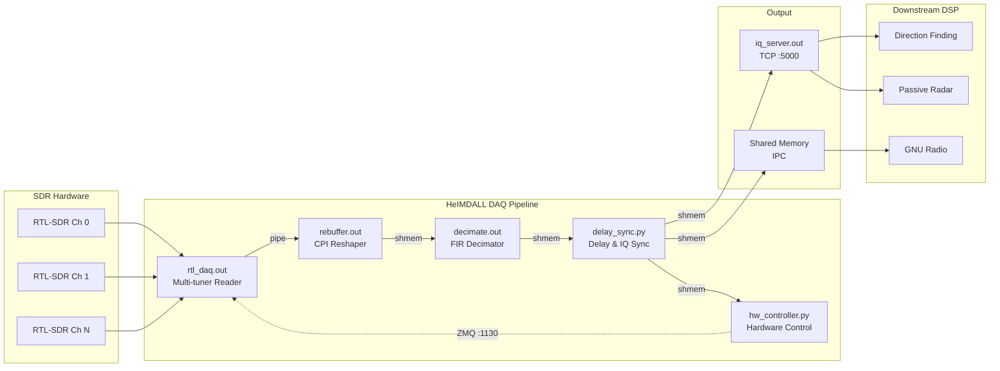

# HeIMDALL DAQ Firmware

[](https://github.com/sonoransun/exheimdall_daq_fw/actions/workflows/ci.yml)

Coherent data acquisition and signal processing chain for KrakenSDR multichannel
RTL-SDR receivers. Designed for Raspberry Pi 4 (ARM64) and x86_64 Linux systems.

HeIMDALL captures raw IQ samples from multiple synchronized RTL-SDR tuners,
performs sample-level and IQ-level calibration across all channels, and delivers
a coherent multichannel IQ stream to downstream DSP applications such as
direction finding, passive radar, and GNU Radio.



## Features

- **Coherent multichannel acquisition.** Cross-correlation sample-delay
  estimation, fractional-delay correction by sampling-frequency PPM tuning,
  and IQ amplitude/phase calibration by eigendecomposition. Sync tracking runs
  continuously. The chain recalibrates on a frequency change or after
  `maximum_sync_fails` consecutive sync failures.
- **Real-time pipeline.** Tiered `SCHED_FIFO` priorities, per-process CPU
  affinity, memory locking and double-buffered shared-memory transport.
- **Runtime control.** TCP control interface (port 5001) and the
  `heimdall-ctl` command-line client: tuning, gains, AGC, recalibration,
  scheduling, RF front-end and antenna-orientation control.
- **Signal scheduling.** Calibration-aware frequency hopping from INI or JSON
  schedules (loop / once / pingpong), per-entry gains and dwell in frames or
  seconds.
- **Monitoring.** JSON status endpoint (port 5002), rolling metrics, a
  structured event bus with optional ZMQ PUB fan-out (port 5003), optional
  syslog.
- **Persistence (optional).** BerkeleyDB-backed frame metrics, calibration
  history, per-frequency scan aggregates and schedule state with age-based
  rotation.
- **Scaling and clustering (optional).** Several instances on one host, each
  with its own receiver unit, ports, cores and working directory. Multi-host
  federation with a coordinator (port 6000), an optional lease election
  between coordinator candidates, master-schedule partitioning, peer health
  monitoring, and an IQ router (port 7000) that merges the streams of many
  instances. Each instance is one coherent island: channels of two instances
  are not phase-coherent with each other. See
  [Scaling and clustering](#scaling-and-clustering-opt-in).
- **RF front-end modelling (optional).** External LNA gain staging, cascaded
  Friis noise-figure budget, P1dB compression advisories, runtime bias-tee
  switching.
- **Antenna orientation (optional).** Rotator/pan-tilt control (GS-232, PWM
  servo, PCA9685 I2C, mock) with autonomous scan-and-peak.
- **Pluggable transport and offload layers.** Shared memory is the default
  and only enabled backend. SPI, PCIe, USB3 and Ethernet transports and the
  FPGA/GPU offload engines are compile-time-optional, experimental drivers.

## Quick Start

On a fresh Debian/Ubuntu/Raspberry Pi OS (64-bit) system:

```bash
git clone https://github.com/sonoransun/exheimdall_daq_fw
cd exheimdall_daq_fw

# Installs build deps, the krakenrf librtlsdr fork, the FIR DSP library
# (KFR on x86_64/aarch64, Ne10 on armv7l), Python packages, RT limits,
# and builds the C core:
./util/install.sh
```

Then run the chain (from `Firmware/`, requires sudo):

```bash
cd Firmware
sudo ./daq_start_sm.sh          # start with real SDR hardware
sudo ./daq_synthetic_start.sh   # or: simulation mode (synthetic data, no receivers)
sudo ./daq_stop.sh              # stop every DAQ process on this host
```

In simulation mode `_testing/test_data_synthesizer.py` replaces `rtl_daq.out`
and answers the ZMQ control messages on port 1130, so the simulated chain can
calibrate. Optional flags: `--pace` (real sample rate), `--blocks N`
(default 10000, 0 = unbounded), `--seed S`, `--rt` (hardware RT tiers).

Configuration lives in `Firmware/daq_chain_config.ini` (presets in
`config_files/`). The start scripts validate the config with
`ini_checker.py` and refuse to start on errors. Check the running chain:

```bash
heimdall-ctl status                                # after pip install .
(cd .. && PYTHONPATH=util python3 -m heimdall_ctl status)   # source tree, no install
```

Logs: instance 0 writes `Firmware/_logs/*.log`; instance N > 0 writes
`Firmware/_logs/inst<N>/*.log`. PID files are kept under
`Firmware/_logs/inst<N>/pids/` (also for instance 0).

If you just want to run the KrakenSDR direction-finding or passive-radar
software, prefer the premade images and install scripts documented in the
[KrakenSDR Wiki](https://github.com/krakenrf/krakensdr_docs/wiki).

## Building from Source

The C core is built from `Firmware/_daq_core/`:

```bash
cd Firmware/_daq_core
make -j4
```

This produces the four pipeline binaries: `rtl_daq.out`, `rebuffer.out`,
`decimate.out`, `iq_server.out`. Rebuild after every update: the binaries and
the Python stages of one release must match (for example, `decimate.out` of
this release reads the prefixed FIR coefficient file of instance N > 0).

### Make variables

| Variable | Values | Meaning |
|----------|--------|---------|
| `ENGINE` | `auto` (default) \| `kfr` \| `ne10` \| `generic` | FIR/convert engine. `auto` resolves per arch: x86_64 → `kfr`, aarch64/arm64 → `kfr`, 32-bit ARM → `ne10`, anything else → `generic`. `generic` is a dependency-free plain-C engine (no KFR/Ne10 needed). |
| `BUILD` | `release` (default) \| `debug` \| `asan` | `debug` = `-Og -g`; `asan` = `-O1 -g -fsanitize=address,undefined`. |
| `MARCH` | unset (default) \| `portable` \| explicit flags | Unset keeps native tuning (`-march=native` / `-mcpu=native`). `portable` drops all arch-specific flags (CI, distributable binaries). Any other value is passed through, e.g. `MARCH='-mcpu=cortex-a72'`. |

> **Note:** aarch64/arm64 defaults to the KFR engine. The historic aarch64
> Ne10 branch never linked (`libNE10.a` is armv7-only). Ne10 remains the
> default only on 32-bit ARM.

The `kfr` and `ne10` builds also compile the generic engine, so
`[offload] fir_engine = generic` is selectable at runtime. Auto-detection still
picks the platform engine by default.

Other targets: `make all-offload` (all optional transport/offload objects),
`make libs` (shared libraries for Python ctypes), `make device_map_probe`
(standalone serial-mapping probe used by the tests), `make pgo-profile` /
`make pgo-optimize` (profile-guided optimization; `make clean` keeps the
`.gcda` profiles, `make distclean` removes them).

### Copy-in dependencies

External libraries are copied **into** `Firmware/_daq_core/` before building
and resolved via `-I. -L.`:

| Files | Needed for | Source |
|-------|-----------|--------|
| `librtlsdr.a`, `rtl-sdr.h`, `rtl-sdr_export.h` | always (`rtl_daq.out`) | [krakenrf/librtlsdr](https://github.com/krakenrf/librtlsdr) fork. The stock distro librtlsdr does **not** work (it lacks `rtlsdr_set_dithering` and others) |
| `libkfr_capi.so*`, `kfr/` headers | `ENGINE=kfr` | [kfrlib/kfr](https://github.com/kfrlib/kfr) (capi build, clang; PIC required on arm64) |
| `libNE10.a` | `ENGINE=ne10` (32-bit ARM only) | [projectNe10/Ne10](https://github.com/projectNe10/Ne10) |

`util/install.sh` performs the whole flow (clone, build, copy-in, `make`) for
x86_64, aarch64 and armv7l. The script is the reference procedure for a manual
build. `ci/build.sh generic|kfr|asan|deploy-lint` gives reproducible lanes (used by CI,
works locally, caches under `.ci-deps/`).

System build packages: `build-essential cmake git libusb-1.0-0-dev libzmq3-dev`
(plus `clang` for KFR).

### Python environment

Python 3.8+ with `numpy`, `scipy`, `pyzmq` and `configparser`. Optional:
`numba` (accelerator for delay_sync, which falls back to plain Python),
`scikit-rf` (only for `[calibration] iq_adjust_source = touchstone`) and
`berkeleydb` (persistent storage). On Raspberry Pi the conda/miniforge environment `kraken` is the
tested setup (see the
[KrakenSDR Wiki](https://github.com/krakenrf/krakensdr_docs/wiki)); on desktop
systems plain `pip` works.

Installing the repo as a package (`pip install .`) installs **only** the
`heimdall-ctl` console script. The DAQ pipeline itself is not a Python package
and runs from the source tree.

## Testing

```bash
cd Firmware

./unit_test.sh --ci      # hardware-free suite: no sudo, no SDR, no C binaries;
                         # Linux and macOS. Exit 0 = all modules passed.
                         # Missing optional deps (C compiler, berkeleydb,
                         # pyzmq, numba) cause SKIPs with a printed reason.

sudo ./unit_test.sh --sudo   # pipeline suites: Linux + root + built C binaries
                             # + the unit_test_k4 config values. The suites
                             # copy the config to a temp dir; the live file
                             # is never modified.

./unit_test.sh --list    # every registered module per lane, present or pending
./unit_test.sh           # legacy behavior: decimator pipeline suite via sudo
```

Modules are registered in `Firmware/unit_test.sh` (`CI_MODULES`,
`SUDO_MODULES`). A registered module whose file is not in the tree yet prints
`PEND` and does not fail the run. `HEIMDALL_STRICT_MODULES=1` turns a missing
module into a failure. `PYTHON=` selects the interpreter.

The full-chain end-to-end test is run separately (real or synthetic chain):
`sudo python3 -W ignore -m unittest -v _testing/unit_test/test_sys.py`.

Individual modules can always be run directly with
`python3 -m unittest -v _testing/unit_test/<module>.py`.

### Continuous integration

`.github/workflows/ci.yml` runs on push to main/master, on pull requests, on
manual dispatch and nightly:

- **c-build**: `ci/build.sh` on `ubuntu-latest` and `ubuntu-24.04-arm`, in
  the `generic` and `kfr` lanes
- **asan**: the core compiled with `-fsanitize=address,undefined`
- **python**: `ini_checker.py no_hw`, `./unit_test.sh --ci`, and a
  `pip install .` + `heimdall-ctl --help` smoke test on Ubuntu and macOS
- **pipeline**: `./unit_test.sh --sudo` on an Ubuntu VM with the generic
  build and the `unit_test_k4` config staged; skipped for documentation-only
  pull requests; the nightly run adds a 600 s multi-instance soak once that
  test module exists
- **deploy-lint**: `ci/build.sh deploy-lint` (ShellCheck and `bash -n` of the
  scripts, `systemd-analyze verify` of the units, `ini_checker.py` on every
  preset, provisioning and `cluster_cfg_gen.py` dry runs, `--help` smoke tests)

There is intentionally no FPGA gateware job: `_fpga_gateware` lint/verify do
not currently pass in a clean environment (see the note in `ci.yml`).

## Configuration

All configuration is in `Firmware/daq_chain_config.ini`
(`ini_version = 8`). Key sections:

| Section | Key Parameters |
|---------|----------------|
| `[hw]` | `num_ch` (1..31), `en_bias_tee`, `unit_id` (integer or `auto` = instance_id); opt-in `serial_base`, `device_serials`, `antenna_switch_gpio` |
| `[daq]` | `center_freq`, `sample_rate`, `gain`, `en_noise_source_ctr`, `ctr_channel_serial_no`, optional `listen_address` (default `0.0.0.0`); opt-in `zmq_listen_address`, `usb_ring_buffers`, `usb_async_transfers`, `ctl_max_connections`, `ctl_request_timeout_sec`, `ctl_handler_max_sec`, `ctl_xack_idle_sec`, `ctl_idle_timeout_sec` |
| `[pre_processing]` | `cpi_size`, `decimation_ratio`, `fir_tap_size`, `fir_window`; opt-in `size_segments_from_config` |
| `[calibration]` | `cal_track_mode`, `corr_size`, `en_iq_cal`, tolerances; opt-in `en_wire_recal`, `cal_timeout_frames`, `invalidate_on_overrun` and others |
| `[data_interface]` | `out_data_iface_type` (shmem/eth); opt-in `iq_server_max_clients`, `iq_server_frame_deadline_ms` |
| `[schedule]` | `en_schedule`, `frequencies`, `dwell_frames` or `dwell_time_sec`, `repeat_mode` |
| `[database]` | `en_db`, `db_dir`, `rotation_max_age_hours`, `write_batch_size`; opt-in `instance_subdir`, `write_instance_meta` |
| `[monitoring]` | `en_monitoring`, `en_syslog`, `en_metrics`, `en_status_server`, `en_zmq_pub`, optional `drop_window_sec` (default 60 s); opt-in `status_extended`, `en_hwc_state_relay`, `event_tag_identity`, `event_topic_prefix`, `stamp_decimator_drops`, `stamp_cal_telemetry` |
| `[offload]` | `rebuffer_transport`, `decimator_transport`, `fir_engine` (`auto`/`kfr`/`neon`/`generic`/`fpga`/`gpu`), `fft_engine`; opt-in `fft_workers`, `xcorr_workers`, `skip_copy_on_drop` |
| `[federation]` | `instance_id`, `port_stride`, `en_federation`, `coordinator_host`/`coordinator_port`, `peer_list`; opt-in `node_id`, `cluster_id`, `cluster_members`, `coordinator_candidates`, `register_with_coordinator`, `health_mode`, `auth_token`, `allow_cidrs` and others |
| `[amplification]` | `en_amplification`, `ext_lna_gains_db`, `ext_lna_nf_db`, `ext_lna_p1db_dbm`, `en_bias_tee_runtime` |
| `[antenna]` | `en_antenna_profile`, `element_gain_dbi`, `beamwidth_az_deg`, `polarization`, `cable_loss_db`, `boresight_az_offset_deg` |
| `[orientation]` | `en_orientation`, `backend` (`mock`/`gs232`/`pwm_servo`/`i2c_pantilt`), `bearing_mode`, `min_sync_state`, `en_scan` |
| `[host]` (opt-in) | `cpu_cores`, `delay_sync_cores`, `rt_priority_offset`, `allow_core_sharing`, `host_tuning`, `preflight`, `instance_registry`, `instance_guard`, `usb_irq_core`, `usb_controller`, `health_thread_sched_other` |
| `[fpga]` `[gpu]` `[pcie]` `[usb3]` `[dma]` `[hat_uart]` `[hat_i2c]` | experimental transport/offload hardware |

Every key added by the scaling program is commented out in the shipped file.
With those keys absent, the chain behaves as before, apart from the
default-path differences listed in
[upgrade_and_rollback.md](Documentation/upgrade_and_rollback.md#4-default-path-changes-in-this-release-ledger-l1-l16).
The optional sections (`[schedule]`, `[database]`, `[monitoring]`,
`[offload]`, `[federation]`, `[amplification]`, `[antenna]`, `[orientation]`,
`[host]`, and the experimental hardware sections) are disabled by default.
Coordinator and router keys (`election_*`, `fanout_*`, `router_*` and others)
live in a separate `federation.ini`. [configuration.md](Documentation/configuration.md)
lists every key.

Presets in `config_files/`:

| Preset | Purpose |
|---|---|
| `kraken_default` | 5-channel KrakenSDR |
| `kerberos_default` | KerberosSDR |
| `kraken_development` | development settings |
| `unit_test_k4` | values the pipeline test suites need |
| `directional_df` | amplified receivers, high-gain antenna and rotator |
| `multi_instance_x86` | instance 1 of an 8-core x86 host with two KrakenSDR units |
| `cluster_site` | instance 0 and the `federation.ini` of a two-host example cluster |
| `performance/` | `minimal.ini`, `balanced.ini`, `maximum.ini`: `[host]` and `[offload]` snippets merged by `util/provision_instance.py --profile`. The `.conf` files are documentation only: nothing reads them |

`Firmware/ini_checker.py` validates a config. Forms:
`python3 ini_checker.py [config_path] [no_hw] [attached]` (exit 0 valid, 1
invalid; `no_hw` skips hardware probes, `attached` adds the sysfs serial and
host-registry checks) and `python3 ini_checker.py federation.ini --federation`
for a coordinator or router config. Warnings go to stderr with the prefix
`WARNING: ` and do not change the exit code. `util/cfg_gen.py` generates a
config from signal parameters.

## Runtime Control: heimdall-ctl

`heimdall-ctl` is the command-line client for a running chain. Install it with
`pip install .` (console script). In a source tree, run
`PYTHONPATH=util python3 -m heimdall_ctl` from the repository root instead.

| Subcommand | Action |
|------------|--------|
| `status [--watch]` | Pipeline status (sync state, frequency, health, drops) |
| `tune <freq>` | Set RF center frequency (`433M`, `1.2G`, `868000000`) |
| `gain [values] [--unified G]` | Set tuner IF gains (dB x 10) |
| `agc` | Enable automatic gain control |
| `recal` | Sends `RECL` when the server advertises it (`[calibration] en_wire_recal = 1`), which also recalibrates a locked chain. Otherwise sends `INIT` and warns: `INIT` re-enters the hw_controller FSM but does not recalibrate a locked chain |
| `metrics` | Rolling performance statistics |
| `events [--tail] [--filter P]` | Recent events (ring buffer via :5002, or live via ZMQ :5003 with `--tail`) |
| `cal-history [--since DUR] [--freq F] [--limit N] [--db-dir DIR] [--remote]` | Calibration history. Reads the local BerkeleyDB directory (default `[database] db_dir`); `--remote` queries the :5002 proxy |
| `freq-scan [--freq F] [--db-dir DIR] [--remote]` | Per-frequency scan summary, local DB or :5002 proxy |
| `db-stats` | Database statistics (:5002 `DB_STATS`) |
| `schedule load\|stop\|query\|next [file]` | Manage the signal schedule (large schedules use the chunked `SCHB`/`SCHC`/`SCHE` transfer) |
| `lna-gain [values] [--unified G]` | Set external LNA gains in dB (the tenths-dB wire encoding is handled by the CLI) |
| `bias-tee [values] [--all on\|off]` | Per-channel inline-LNA bias-tee power |
| `bearing <az> [el]` | Slew the antenna to a bearing |
| `park` | Park the antenna at its configured bearing |
| `scan start\|stop` | Autonomous scan-and-peak control |
| `orientation` | Query rotator/orientation state |
| `rf-budget` | Query the RF link budget (total gain, NF, compression) |
| `hwc-status` | hw_controller control snapshot (`HWSQ`) |
| `track-lock [approve\|revoke]` | Query (`TLCK`) or set (`TLKA`) the IQ track lock |
| `peers` | This instance's federation peer table (:5002 `PEERS`, needs `status_extended = 1`) |
| `ports` | The port window of an instance, from the config |
| `instances [--ping]` | Instances in the host registry (only those started with `[host] instance_registry = 1`) |
| `capacity` | Run the capacity pre-flight tool (`daq_preflight.py`) |
| `config-show` | Display the resolved configuration |
| `fleet <verb>` | Cluster commands through the coordinator: `status`, `ping`, `version`, `leader`, `health`, `peers`, `assignments`, `db-stats`, `router-stats`, `members`, `tune`, `gain`, `lna-gain`, `bias-tee`, `agc`, `recal`, `park`, `bearing`, `hwc-status`, `exec`, `schedule`, `rebalance`, `events` |
| `router stats\|sources\|clients [--watch]` | IQ router statistics (port 7001) |

Global flags: `--host`, `--port-ctl`, `--port-status`, `--port-events`,
`--config`, `--instance N` (adds `N * port_stride` to every port),
`--port-stride`, `--coordinator H:P[,H:P...]`, `--router H:P`, `--auth-token`
(or `HEIMDALL_AUTH_TOKEN`), `--timeout`, `--ack auto|xack|legacy`
(`--legacy-ack`), `--strict`, `--verify`, `--firmware-dir`, `--json`, `-v`,
`--color`.

Exit codes: 0 ok, applied, or unconfirmed by a previous-release server;
1 error or not applied; 2 usage; 3 connection failure or timeout;
4 `not_leader`; 5 capacity failures.

Mutating commands first send `XACK` to learn whether the server confirms
application. A previous-release server answers `FNSD` + zeros, the client
caches it as legacy for 24 h and prints
`sent; server does not confirm application (legacy server)`.

```bash
heimdall-ctl tune 433M
heimdall-ctl bearing 137.5 12
heimdall-ctl scan start
heimdall-ctl rf-budget --json
heimdall-ctl --instance 1 status
```

A scripted client example for the RF front-end and orientation commands is at
`util/orientation_scan_example.py`.

## Network Interfaces

Per-instance ports (5000-5003 and 1130) follow
`effective_port = base_port + instance_id * port_stride` (default stride 100).
Instance 0 uses the bases below. The coordinator (6000) and the router (7000,
7001) are single services and are not offset by instance. With stride 100,
keep instance ids at 0-9 per host: ids 10 and 20 collide with 6000 and 7000.

| Port | Protocol | Bind key | Purpose |
|------|----------|----------|---------|
| 5000 | TCP | `[daq] listen_address` | IQ frame streaming. The client sends `streaming`, the server sends `[1024-byte header][payload]` per frame, the client acks each with `IQDownload`. One client by default (`[data_interface] iq_server_max_clients`) |
| 5001 | TCP | `[daq] listen_address` | Control: exactly 128-byte frames, 4-byte ASCII verb + 124-byte payload. Replies are 128 bytes starting `FNSD`. Verbs: `FREQ` `GAIN` `AGC ` `INIT` `SCHD` `SCHS` `SCHQ` `SCHN` `EGAN` `BIAS` `RFQ ` `ORNT` `PARK` `SCAN` `OSTP` `OQRY`, plus `XACK` `HWSQ` `SCHG` `TLCK` `TLKA` `RECL` `SCHB` `SCHC` `SCHE`. Query verbs answer JSON in any FSM state |
| 5002 | TCP | `[daq] listen_address` | Status: newline-terminated text commands `PING` `STATUS` `METRICS` `EVENTS` `EVENTS_DROPPED` `DB_STATS` `SCAN_SUMMARY [freq]` `CAL_HISTORY [freq]`, plus `PEERS` `HWC` `HW_SNAPSHOTS` with `[monitoring] status_extended = 1`. One JSON object + `\n` per command |
| 5003 | ZMQ PUB | `[daq] listen_address` | Event stream from delay_sync, topic = event type (or `inst<N>.<type>` with `event_topic_prefix = 1`) |
| 1130 | ZMQ REQ/REP | `[daq] zmq_listen_address` (default `*`) | Internal tuner control (128-byte messages, command chars `r c g a s n b h`; `r` is deprecated) |
| 6000 | TCP | `--listen-address`, else `[daq] listen_address` of `--config` | Federation coordinator (opt-in) |
| 7000 | TCP | same as 6000 | Federation IQ router merged output (opt-in) |
| 7001 | TCP | same as 7000 | IQ router statistics (opt-in) |

The coordinator and router are not started by any default script.
[protocols.md](Documentation/protocols.md) is the wire reference.
[networking_and_time_sync.md](Documentation/networking_and_time_sync.md)
covers firewalls, authentication and clocks.

## Monitoring & Observability

- **Status server** (`daq_status_server.py`, port 5002): pipeline state,
  counters, and windowed health. `ok` when `sync_state >= 5` with zero frame
  drops inside the rolling window (`[monitoring] drop_window_sec`, default
  60 s); `degraded` when `sync_state >= 2`; `error` otherwise. `STATUS`
  replies include `instance_id`, `recent_drops` and `drop_window_sec`.
  `[monitoring] status_extended = 1` adds staleness fields
  (`snapshot_age_sec`, `stale_after_sec`, health `stale`), the `hwc` and
  `federation` blocks, and the extra verbs.
- **Metrics** (`daq_metrics.py`): O(1) recording into circular numpy buffers.
  `METRICS` returns min/max/avg/p95 per metric (frame latency, throughput,
  drop-rate deltas).
- **Event bus** (`daq_events.py`): non-blocking dispatch to Python logging,
  syslog and a ring buffer in each process. Only delay_sync publishes on ZMQ
  PUB :5003 (`en_zmq_pub = 1`). That stream carries sync, calibration-start,
  frequency-change, heartbeat, frame-drop, DB and federation-peer events.
  Gain, scheduling, noise-source, overdrive, RF front-end and orientation
  events come from hw_controller, whose bus has no PUB socket. They reach
  :5003 only with `[monitoring] en_hwc_state_relay = 1`, which relays them
  through delay_sync.
- **Persistence** (`daq_db.py`, optional `berkeleydb`): frame metrics,
  calibration history, per-frequency scan aggregates, hardware snapshots and
  schedule state, written from a background thread with age-based rotation.
  The on-disk format is **schema generation 2** (big-endian keys, versioned
  records). A generation-1 database directory is discarded and recreated on
  the first read-write open. The port-5002 `DB_STATS` / `SCAN_SUMMARY` /
  `CAL_HISTORY` commands read it live; `heimdall-ctl cal-history` and
  `freq-scan` read the directory locally unless `--remote` is given.

Frame-level telemetry also travels in-band. The 1024-byte IQ header
(version 8) carries named slots in its reserved region: external LNA gains,
total system gain, system noise figure, compression flags, bias-tee state,
antenna bearing, rotator state, aggregate channel power, and a cumulative USB
ring-buffer overrun counter (slot 102). Slots 103-113 are new and stay zero
unless their opt-in key or router flag is set: router sequence and receive
time (103-105), source instance and node-key CRC (106-107), node-id CRC (108),
decimator drop count (109), and calibration telemetry (110-113). Consumers
that ignore the reserved region parse every frame unchanged.

## Scaling and clustering (opt-in)

One instance is one complete pipeline on one receiver unit. Its channels are
coherent. Channels of two instances are not. Scale one instance first (more
channels, decimation, CPI size); add instances to cover more units, bands or
sites. With every new key absent and no new flag passed, nothing in this
section runs.

| Capability | Tools and keys |
|---|---|
| Distinct receivers per instance | `[hw] serial_base` or `device_serials`; `util/set_unit_serials.sh` programs unit K to `1000 + 100*K + i` |
| One working directory per instance | `util/provision_instance.py` (dry run unless `--write`); instance N > 0 lives in `<root>/instances/<N>` with symlinked code and private config, `_data_control/`, `_logs/`, `_db/` |
| Cores, priorities, host tuning | `[host] cpu_cores`, `rt_priority_offset`, `host_tuning`, `util/host_tuning.sh` |
| Registry and duplicate-start guard | `[host] instance_registry = 1` (files in `$HEIMDALL_RUN_DIR`, default `/run/heimdall`), `instance_guard = refuse`, `heimdall-ctl instances` |
| Scoped stop and cleanup | `daq_stop.sh N [--clean] [--reset-fence]`, `--this-copy`, `--all`, `--federation` |
| Supervision | `Firmware/daq_supervise.sh --instance N`: exits 10-15 naming the failed stage, 16 on a failed health check |
| Capacity check | `Firmware/daq_preflight.py` (exit 0 ok, 1 warnings, 2 failures, 3 usage), `[host] preflight = off\|warn\|strict` (default `off`), `heimdall-ctl capacity` |
| Cluster config generation | `util/cluster_cfg_gen.py` writes per-instance INIs, `federation.ini`, `ports.md` and `provision.sh` |
| Coordinator | `_daq_core/federation_coordinator.py` (port 6000, protocol v2): fans out `FREQ`/`GAIN`/`ALL`/`NODE`/`FANOUT`, sends `XACK` before every member command, aggregates `STATUS` and `HEALTH` from each member's :5002, takes a master schedule with `SCHEDULE SET` and distributes it with `REBALANCE`. Optional lease election with fencing between `[federation] coordinator_candidates` |
| Peer health | `FederationHealth` in delay_sync polls peers' :5002 and emits `peer_up`/`peer_down`; `peer_degraded`/`peer_recovered`/`peer_flapping` with `emit_peer_health_events = 1`. Its `coordinator_elected` event is advisory telemetry; nothing acts on it |
| IQ router | `_daq_core/federation_iq_router.py`: reads each instance's :5000, serves merged frames on 7000 with bounded per-client queues, tagging (`--tag-mode instance\|unit\|node`) and optional time alignment; statistics on 7001 |
| Launchers | `Firmware/federation_start.sh coordinator\|router\|all`, `federation_stop.sh` (no root needed) |

Limits: a 4-core host such as a Raspberry Pi 4 fits one hardware instance
(each instance pins 4 cores). Two units on one USB 2.0 bus do not fit the
capacity model's 35 MB/s budget. Every member of a federation needs
`[monitoring] en_monitoring = 1` and `en_status_server = 1`; the router needs
`[data_interface] out_data_iface_type = eth`. The systemd units for the
supervisor, coordinator, router and host tuning are not shipped yet; see
[Deployment](#deployment).

### Quick start: two instances on one host

An 8-core x86 host with two KrakenSDR units, installed in `/opt/heimdall`.
Each command is explained in
[deployment_recipes.md](Documentation/deployment_recipes.md#recipe-c-two-krakensdrs-on-one-x86-host).

```bash
cd /opt/heimdall/Firmware/_daq_core && make
# Plug in unit 1 alone: program its serials to 1100-1104, then power-cycle it
sudo /opt/heimdall/util/set_unit_serials.sh --unit 1 --yes

cd /opt/heimdall
sudo sed -i 's/^out_data_iface_type = .*/out_data_iface_type = eth/' Firmware/daq_chain_config.ini
sudo python3 util/provision_instance.py --instance 0 --in-place --write
sudo python3 util/provision_instance.py --instance 1 --write

cd /opt/heimdall/Firmware
python3 daq_preflight.py --config daq_chain_config.ini ../instances/1/Firmware/daq_chain_config.ini
sudo ./daq_start_sm.sh                                   # instance 0: ports 5000-5003
cd /opt/heimdall/instances/1/Firmware && sudo ./daq_start_sm.sh   # instance 1: ports 5100-5103

heimdall-ctl instances
heimdall-ctl --instance 1 status
sudo ./daq_stop.sh 1          # stops instance 1 only
```

Never run the no-argument `./daq_stop.sh` on a multi-instance host unless you
mean to stop every instance: it is the host-wide kill.

### Quick start: a two-host federation

One instance on `hosta` and one on `hostb` (unit 1, serials 1100-1104), a
static coordinator and a central router on `hosta`, and a per-host router on
`hostb`. Use the hosts' real names, never `localhost`. Each step is explained
in [deployment_recipes.md](Documentation/deployment_recipes.md#recipe-d-multi-site-networked-df)
and [scaling_and_clustering.md](Documentation/scaling_and_clustering.md#5-multi-host-federation).

```bash
# On one host: set eth output in the template, then generate the cluster files
cd /opt/heimdall
sudo sed -i 's/^out_data_iface_type = .*/out_data_iface_type = eth/' Firmware/daq_chain_config.ini
python3 util/cluster_cfg_gen.py --template Firmware/daq_chain_config.ini \
    --hosts hosta:1 hostb:1 --coordinators hosta:6000 --router hosta:7000 --out cluster/
# -> cluster/federation.ini, cluster/hostb/federation.ini, cluster/ports.md,
#    cluster/provision.sh, cluster/<host>/inst<N>/daq_chain_config.ini

# On hostb, with only its unit plugged in: program serials 1100-1104,
# then power-cycle the unit
sudo /opt/heimdall/util/set_unit_serials.sh --unit 1 --yes

# On each host (copy cluster/ there first): provision and start its instance
sudo sh cluster/provision.sh
cd /opt/heimdall/Firmware && sudo ./daq_start_sm.sh

# On hosta: coordinator and central router
./federation_start.sh all --config /opt/heimdall/cluster/federation.ini
# On hostb: its per-host router
./federation_start.sh router --config /opt/heimdall/cluster/hostb/federation.ini

# From an operator host
heimdall-ctl --coordinator hosta:6000 fleet status
heimdall-ctl --coordinator hosta:6000 fleet tune 433.92M
heimdall-ctl --router hosta:7001 router stats
```

`cluster_cfg_gen.py` exits 1 on a port collision or a core plan that exceeds
a host. It warns when `auth_token` and `allow_cidrs` are empty: then the
coordinator accepts mutating commands from any host. Set them before you
expose port 6000 (see
[networking_and_time_sync.md](Documentation/networking_and_time_sync.md)).
Timestamps from different hosts are comparable only with NTP or PTP on every
host.

## RF Front-End & Antenna Orientation

Three optional subsystems, all disabled by default and all running inside
`hw_controller.py` (no extra processes):

- **`[amplification]`** models external LNAs ahead of the tuner: per-channel
  continuous-dB gain (`EGAN`), cascaded Friis noise figure, P1dB compression
  headroom (advisory only, never auto-changes gains), and runtime bias-tee
  switching (`BIAS`; GPIO 0 stays reserved for the noise source, and bias
  changes defer during calibration bursts).
- **`[antenna]`** is the antenna profile (element gain dBi, beamwidth,
  polarization, cable loss, boresight offset). It feeds both the link budget
  and the pointing logic.
- **`[orientation]`** is a rotator/pan-tilt state machine with GS-232 serial,
  PWM-servo, PCA9685 I2C and mock backends (the factory falls back to mock so
  the chain always starts). Bearing sources: external `ORNT`, a configured
  fixed/park bearing, or autonomous scan-and-peak (`SCAN`) maximizing the
  aggregate channel power stamped in the IQ header. Motion is gated on sync
  state and the noise source, so the array never slews mid-calibration.

See `config_files/directional_df/` for a complete worked preset and
`heimdall-ctl lna-gain / bias-tee / bearing / scan / rf-budget / orientation`
for runtime control.

## Architecture Notes

- **Processes and RT layout.** `daq_start_sm.sh` sets the priorities and
  cores. Defaults per instance N: tier k (0-3) runs on core
  (4N + k) mod nproc, or on `[host] cpu_cores`. `[host] rt_priority_offset`
  lowers every priority.

  | Priority (FIFO) | Process | Core | Role |
  |---|---|---|---|
  | 99 | `rtl_daq.out` | 0 | USB reader |
  | 94 | `rebuffer.out` | 1 | CPI reshaper |
  | 92 | `decimate.out` | 1 | FIR decimator |
  | 90 | `delay_sync.py` | 2 (or `[host] delay_sync_cores`) | Calibration and sync |
  | 88 | `iq_server.out` | 2 (unpinned on hosts with fewer than 4 cores) | TCP output, eth mode only |
  | 82 | `hw_controller.py` | 3 | Control plane |

- **IPC.** Double-buffered POSIX shared memory (`<name>_A`/`<name>_B`) with
  single-byte FIFO signaling (`A_BUFF_READY=1`, `B_BUFF_READY=2`,
  `INIT_READY=10`, `TERMINATE=255`) over forward/backward FIFOs in
  `_data_control/`. Drop mode uses `O_NONBLOCK`. Instance N > 0 prefixes
  every FIFO, shm segment and control file with `inst<N>_`.
- **IQ header.** 1024-byte binary header on every frame (sync word
  `0x2bf7b95a`, version 8), defined in lockstep in `iq_header.h` and
  `iq_header.py`. A C-vs-Python cross-check test enforces the ABI.
- **Transport abstraction.** `transport.h/c` vtable with a
  `transport_create()` factory. The default `TRANSPORT_SHM` backend wraps the
  legacy shared-memory code and behaves identically. SPI/PCIe/USB3/Ethernet
  drivers are compile-time optional (`HAS_*_TRANSPORT`) and off by default.
- **Offload abstraction.** `offload.h/c` FIR/convert engine vtable with
  auto-detection: KFR (x86_64, aarch64), Ne10/NEON (32-bit ARM), generic
  plain-C (any platform). The FPGA and GPU engines are experimental,
  non-functional stubs. The C FPGA engine (`offload_fpga.c`) does not use the
  SPI framing or register map of the separate `_fpga_gateware/` (Yosys/nextpnr,
  ECP5/iCE40), so the two cannot run together. No QPU shader ships for the
  GPU (VideoCore VI) engine, so it always runs the FIR on the CPU.
- **Startup.** `daq_start_sm.sh` validates the config
  (`ini_checker.py no_hw attached`), regenerates FIR coefficients
  (`fir_filter_designer.py` → `_data_control/<P>fir_coeffs.txt`), runs
  hardware discovery (`hw_discover.py` → `_data_control/<P>hw_caps.json`),
  creates the FIFOs and `<P>iq_track_lock`, then launches the pipeline with
  RT priorities. `<P>` is empty for instance 0.

For subsystem depth see the [documentation index](Documentation/README.md).
It groups every document and gives a reading path for new users,
integrators, cluster operators and developers.

## Deployment

`packaging/` contains:

- `systemd/heimdall-daq.service`: single-instance unit wrapping
  `daq_start_sm.sh`/`daq_stop.sh` with the required `LimitRTPRIO`/
  `LimitMEMLOCK` grants. Its `ExecStop` runs the no-argument `daq_stop.sh`,
  which stops every instance on the host, so do not use it beside templated
  instances.
- `systemd/heimdall-daq@.service`: per-instance template for
  `/opt/heimdall/instances/%i/Firmware`, stopped with `daq_stop.sh %i`
- `logrotate/heimdall`: rotation for `/opt/heimdall/Firmware/_logs/*.log` and
  `/opt/heimdall/Firmware/_logs/inst*/*.log`, the instance-0 tree only. A
  provisioned instance N logs to
  `/opt/heimdall/instances/<N>/Firmware/_logs/inst<N>/*.log`, and the
  federation services log to `_logs/federation/*.log`. Add your own entries
  for those paths.

See `packaging/systemd/README.md` for the install procedure. Units for the
supervisor, the coordinator, the router, host tuning and a watchdog are
specified but not in this tree yet. Until they land, run `daq_supervise.sh`
and `federation_start.sh --foreground` from your own units.

## Project Structure

The tree shows the main paths. It is not exhaustive.

```
exheimdall_daq_fw/
├── Firmware/
│   ├── _daq_core/                    # Pipeline core (C + Python)
│   │   ├── Makefile                  # ENGINE/BUILD/MARCH build system
│   │   ├── rtl_daq.c/h               # Multi-tuner SDR reader
│   │   ├── device_map.c/h            # Channel -> EEPROM serial mapping
│   │   ├── rebuffer.c                # CPI block reshaper
│   │   ├── fir_decimate.c            # FIR filter + decimation
│   │   ├── iq_server.c               # TCP IQ server (:5000)
│   │   ├── iq_header.h/c/py          # 1024-byte IQ frame header (lockstep C+Python)
│   │   ├── frame_sizes.h             # size_t shm segment sizes (mirrored by capacity_model.py)
│   │   ├── sh_mem_util.c/h           # Shared memory + FIFO signaling
│   │   ├── delay_sync.py             # Delay & IQ synchronizer, status/metrics/DB hooks
│   │   ├── hw_controller.py          # Control plane: tuner, scheduler, RF front-end, orientation
│   │   ├── hwc_relay.py              # hw_controller -> delay_sync relay files
│   │   ├── shmemIface.py             # Python shared-memory interface
│   │   ├── transport*.c/h, transportIface.py   # Pluggable transport layer (shm default)
│   │   ├── offload*.c/h              # FIR/convert engines: kfr, neon, generic, fpga, gpu
│   │   ├── offload_engines.py, offload_gpu.py  # Python FFT/correlation engines
│   │   ├── signal_scheduler.py       # Calibration-aware frequency scheduler
│   │   ├── gain_budget.py            # Link budget (gain/NF/P1dB)
│   │   ├── antenna_profile.py        # Antenna characterization
│   │   ├── orientation_controller.py # Orientation state machine + scan-and-peak
│   │   ├── rotator_controller.py     # Rotator backends (mock/gs232/pwm_servo/i2c_pantilt)
│   │   ├── daq_db.py, daq_db_records.py        # BerkeleyDB persistence (schema gen 2)
│   │   ├── daq_status_server.py      # JSON status endpoint (:5002)
│   │   ├── daq_metrics.py, daq_events.py       # Metrics + event bus (:5003)
│   │   ├── federation_*.py           # Coordinator, election, health, scheduler, IQ router, common helpers
│   │   ├── capacity_model.py         # Per-instance resource model (pre-flight)
│   │   ├── version.py                # FW_VERSION
│   │   ├── hw_discover.py, auto_config.py      # Capability discovery + auto config
│   │   └── inter_module_messages.py  # ZMQ tuner-control messages (:1130)
│   ├── _fpga_gateware/               # Experimental FPGA gateware (ECP5/iCE40, Yosys+nextpnr)
│   ├── _testing/                     # Test suites, generators, synthesizer, analyzers
│   ├── _data_control/                # Runtime FIFOs + relay/control files
│   ├── _db/                          # Default BerkeleyDB dir (private per provisioned instance)
│   ├── _calibration/                 # Touchstone cable files (iq_adjust_source = touchstone)
│   ├── _logs/                        # Runtime logs (inst<N>/ per instance, federation/)
│   ├── daq_chain_config.ini          # Main configuration (ini_version 8)
│   ├── daq_start_sm.sh               # Start with real hardware
│   ├── daq_synthetic_start.sh        # Start in simulation mode
│   ├── daq_stop.sh                   # Stop (global, per instance, --clean, --legacy)
│   ├── daq_common.sh                 # Helpers sourced by the scripts
│   ├── daq_supervise.sh              # Per-instance supervisor
│   ├── federation_start.sh, federation_stop.sh   # Coordinator / router launchers
│   ├── daq_preflight.py              # Capacity pre-flight check
│   ├── unit_test.sh                  # Test runner (--ci / --sudo / --list)
│   ├── ini_checker.py                # Config validator (exit-code contract)
│   └── fir_filter_designer.py        # FIR coefficient generator (auto-run at start)
├── config_files/
│   ├── kraken_default/               # 5-channel KrakenSDR preset
│   ├── kerberos_default/             # KerberosSDR preset
│   ├── kraken_development/           # Development preset
│   ├── unit_test_k4/                 # Pipeline-test configuration
│   ├── directional_df/               # Amplified receivers + rotator preset
│   ├── multi_instance_x86/           # Instance 1 of a two-unit x86 host
│   ├── cluster_site/                 # Example cluster: instance INI + federation.ini
│   └── performance/                  # --profile snippets (.ini) + legacy .conf (docs only)
├── util/
│   ├── install.sh                    # Full dependency + build installer
│   ├── heimdall_ctl/                 # heimdall-ctl CLI package (pip-installable)
│   ├── provision_instance.py         # Instance-directory provisioning
│   ├── cluster_cfg_gen.py            # Cluster config generator
│   ├── set_unit_serials.sh           # EEPROM serial programming per unit
│   ├── host_tuning.sh                # Host-global tuning (sysctl, IRQ, usbfs)
│   ├── cfg_gen.py                    # Config generator
│   ├── orientation_scan_example.py   # RF front-end / orientation client example
│   ├── system_tuning.py              # RT system optimization
│   ├── irq_tuning.sh, kernel_tuning.conf   # Legacy IRQ / kernel tuning helpers
│   ├── kerberos_eeprom_init.sh       # KerberosSDR EEPROM initialisation
│   └── performance_monitor.py        # Per-process performance tracking
├── ci/build.sh                       # Reproducible lanes (generic/kfr/asan/deploy-lint)
├── .github/workflows/ci.yml          # CI: C matrix, asan, Python, pipeline, deploy-lint
├── packaging/                        # systemd units + logrotate policy
├── Documentation/                    # In-depth documentation (start at README.md)
├── pyproject.toml                    # heimdall-ctl packaging + pytest config
├── CONTRIBUTING.md                   # Contributor guide
└── CHANGELOG.md                      # Release notes
```

## License

GNU General Public License v3.0, see `LICENSE`.

Authors: Tamas Peto, Carl Laufer
